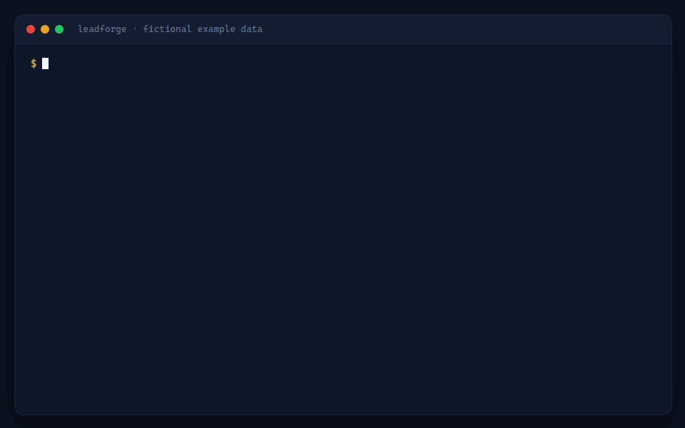
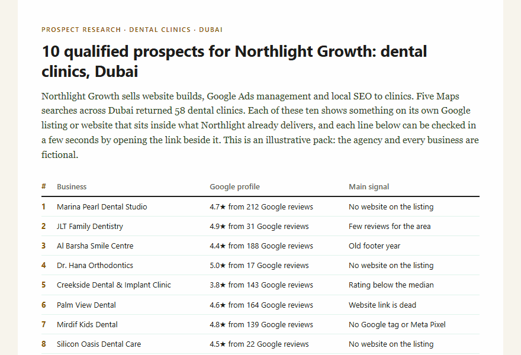
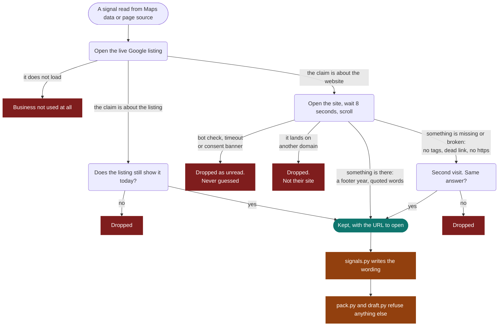
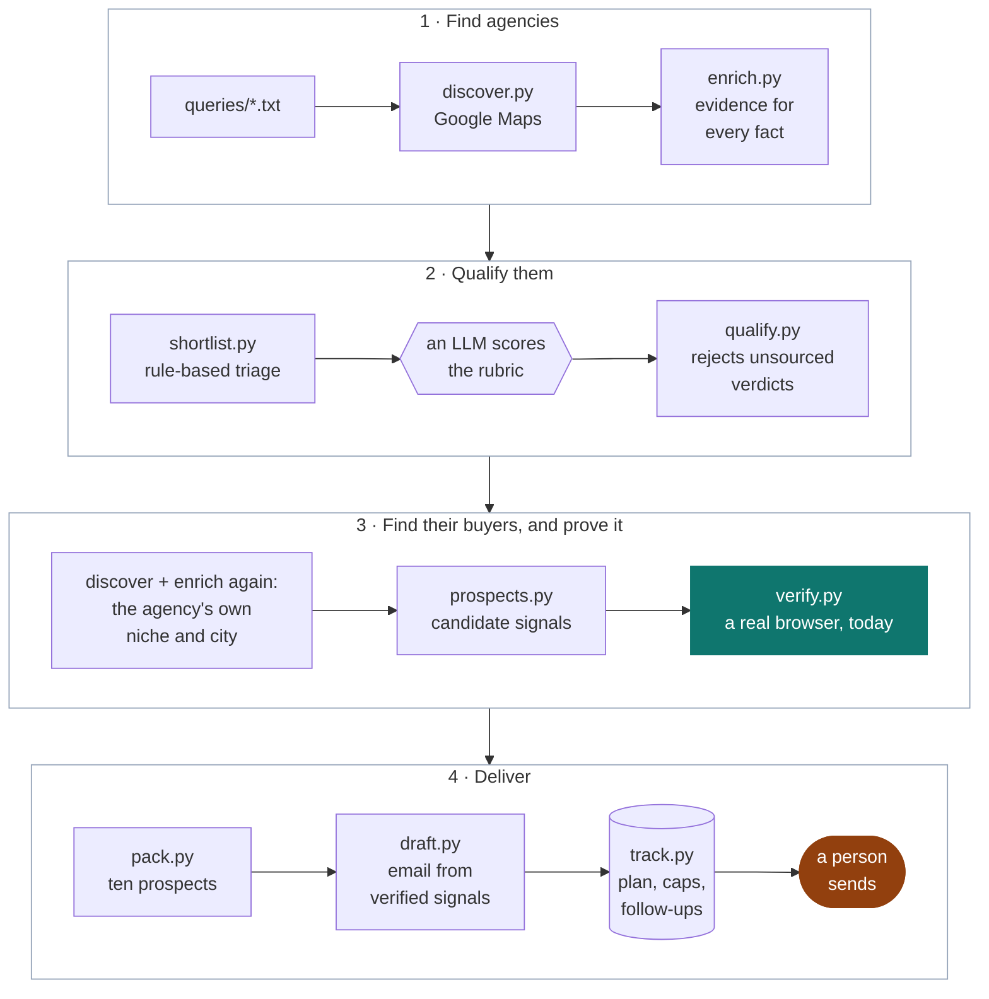
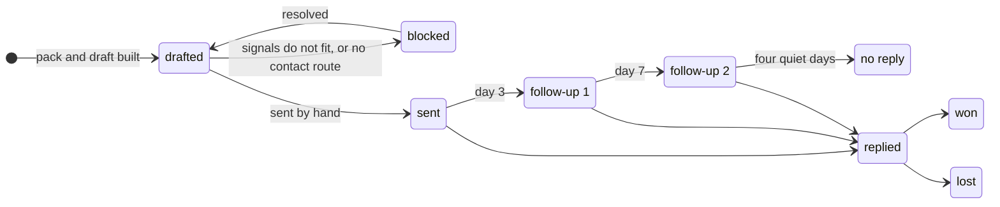

<div align="center">



<br><br>

<a href="https://github.com/TaimourKhan2132/Lead-Forge/actions/workflows/checks.yml"></a>
<a href="https://github.com/TaimourKhan2132/Lead-Forge/releases/latest"></a>
<a href="LICENSE"></a>


<br><br>

<a href="https://taimourkhan2132.github.io/Lead-Forge/"></a>

<br><br>

<b>
<a href="#see-it-work">See it work</a> &nbsp;·&nbsp;
<a href="#the-seven-signals">The seven signals</a> &nbsp;·&nbsp;
<a href="#how-a-claim-survives">How a claim survives</a> &nbsp;·&nbsp;
<a href="#architecture">Architecture</a> &nbsp;·&nbsp;
<a href="#run-it">Run it</a>
</b>

</div>

<br>

LeadForge finds small marketing and automation agencies, works out who their buyers are, and builds
each one a free sample: **ten prospects in its own niche and city**. Every line in that sample is
something a person can confirm in ten seconds on a phone, and it comes with the link to open. Then it
drafts the outreach. A person sends it.

<table>
<tr>
<td align="center"><b>325</b><br><sub>agencies discovered</sub></td>
<td align="center"><b>73</b><br><sub>scored against the rubric</sub></td>
<td align="center"><b>19 of 20</b><br><sub>packs that survived re-verification</sub></td>
<td align="center"><b>7</b><br><sub>signals it is allowed to use</sub></td>
<td align="center"><b>0</b><br><sub>messages it has ever sent</sub></td>
</tr>
</table>

## See it work

<div align="center">

<br>
<sub>Real output, fictional data. The example is built, an email written the old way is refused, and the tests run.</sub>
</div>

<br>

The page an agency receives when it says yes:

<div align="center">

</div>

<br>

And the email that earns that yes. The three lines about businesses are not typed by anyone:
`draft.py` generates them from signals a browser confirmed that day.

```text
Hi Dana,

Your services page lists website builds, Google Ads management and local SEO for clinics.

I run a lead-research pipeline. It found 10 dental clinics in Dubai that fit what you sell. Three of them:

Marina Pearl Dental Studio: 212 reviews at 4.7, no website on its Google listing
Karama Dental Point: 157 reviews, site has no https, footer still says 2018
Creekside Dental & Implant Clinic: 143 reviews, rated 3.8 against a search median of 4.7

Want the other 7? Just reply yes.
```

Under every email sits the list a human works through before sending it. One line per claim, one URL per line:

```text
1. Marina Pearl Dental Studio
   - 212 reviews at 4.7: https://maps.example/place/EXAMPLE01
   - no Website button on its Google listing: https://maps.example/place/EXAMPLE01
2. Karama Dental Point
   - 157 reviews: https://maps.example/place/EXAMPLE10
   - its https address does not load: https://karamadentalpoint.example/
   - the site opens over plain http: http://karamadentalpoint.example/
   - the footer copyright says 2018 (scroll to the bottom): http://karamadentalpoint.example/
```

**[See all of this on the live page](https://taimourkhan2132.github.io/Lead-Forge/)**, where the pack is
served as the page an agency would open and each line of the email lights up the checks it depends on.

Or browse the files:
[the pack](examples/northlight-growth.example.md) ·
[the printable page](examples/northlight-growth.example.html) ·
[the email, follow-ups and check list](examples/northlight-growth.example.email.md) ·
[an email the linter refuses](examples/rejected.example.md).
The agency and every business in it are fictional. No scraped data is stored in this repository.

## It got this wrong first

> [!IMPORTANT]
> The first version told agencies that businesses had "no booking system", "no WhatsApp" and "no chat".
> A manual check found **most of those claims were false**. A page scan sees tools embedded in a page.
> It does not see a "Book now" button that opens another site, or a chat widget a script injects two
> seconds later. "None found" had been reported as "none there".

So the pipeline was rebuilt around one question: *can a person check this in ten seconds?*

- Every claim that something is **missing from a site** was retired, for good.
- What remains are seven things that are there to be seen, plus words quoted from the business's own site.
- Of 20 packs, 19 were rebuilt from signals verified that day. One was **blocked instead of stretched**:
  its pool had 8 prospects with a signal that agency could act on, and a pack needs 10.
- The operator then spot-checked 7 rebuilt claims by hand. 5 were right and **2 were wrong**, both caused
  by a listing link that did not lead where it appeared to. Three rules were tightened that evening.

The history is in the [changelog](CHANGELOG.md) and, run by run, in [RUNLOG.md](RUNLOG.md).

## The seven signals

A pack or an email may say only this about a business.

| | Signal | What it means exactly | How you check it in ten seconds |
|:-:|---|---|---|
| 1 | **No website on the Google listing** | The live listing has no Website button | Open the listing |
| 2 | **Dead website link** | DNS says the name does not exist, the server answers 404 or 410, or the page says the account is suspended or the domain is for sale. A timeout is never proof | Tap Website on the listing |
| 3 | **No https** | The https version of the same URL fails to load or has an invalid certificate. One that answers and redirects is not a failure | Open the https address |
| 4 | **Old footer year** | The newest year beside a copyright mark is 2023 or older | Scroll to the footer |
| 5 | **No Google tag or Meta Pixel** | After 8 seconds in a real browser: no `dataLayer`, `gtag` or `fbq` in any frame, no tag script, no tag request, on two separate visits | Desktop only: type the three names in the console |
| 6 | **Few reviews** | Under half the median review count of the listings the same searches returned | Read the count on the listing |
| 7 | **Low rating** | Under 4.0 and at least 0.4 below the median rating of those listings | Read the rating on the listing |

And one thing more: **text quoted from the business's own site**, re-read on the rendered page on the day.

<details>
<summary><b>Retired, and what the linter does about it</b></summary>

<br>

No booking · no online booking · book button with no booking system · no WhatsApp · no chat · no enquiry
chat · no social profiles linked. Also gone, because they were never checkable in ten seconds: no meta
description, no mobile viewport, listing links to a social profile.

`lint_drafts.py` rejects their wording anywhere in a draft, comments included:

```console
$ python src/lint_drafts.py examples/rejected.example.md
FAIL examples/rejected.example.md
   - retired signal wording: no booking
   - retired signal wording: book button with no booking system
   - retired signal wording: no WhatsApp
   - retired signal wording: no chat
   - retired signal wording: no social profiles linked
   - retired signal wording: the 'checked twice in a real browser' sentence
```

</details>

## How a claim survives

Nothing is believed because a crawler said so. `verify.py` opens the live Google listing and the website
in the installed browser, on the day, and a signal has to get through this:



A dropped signal costs a prospect. A wrong one costs the sender their credibility with the first reader
who checks, so the trade is always made the same way.

## Architecture



Stage 3 is what makes this a product and not only a prospecting tool. Once an agency qualifies,
discovery and enrichment run again against *that agency's* customers, and the result is its sample pack.

**The model judges, the code checks.** Scoring an agency is a judgement call, so a model makes it.
Arithmetic, tier boundaries, evidence, wording and send rules are not, so code owns those.

## Guardrails

Each rule is enforced by code, not by remembering it.

| Rule | Enforced by |
|---|---|
| Nothing is ever sent | There is no sending code. `track.py` only records what a person did |
| Only the seven signals, plus quoted text | `signals.py` is the single list; `pack.py` and `draft.py` refuse anything else |
| Wording cannot outrun the check | `signals.py` writes every phrase; the email's business lines are generated, not typed |
| A check goes stale | `pack.py` refuses a business not verified in the last three days |
| Retired claims stay retired | `lint_drafts.py`, over the whole draft |
| An opening line says only what the agency's page says | `draft.py quotes` re-reads the page and records the result beside the link |
| No real business ever reaches git | `audit_public.py` searches every commit on every ref, and the built live page, for each name, domain and email in the private data folder |
| The send rules | `track.py plan` and `track.py today` |

The rules that can run offline are under test: `python -m pytest`.

## A lead's life



The tracker schedules a new email only on a day where its two follow-ups will also fit.

| Send rule | |
|---|---|
| New emails a day | 10 at most |
| Messages a day, with follow-ups | 15 at most, follow-ups first |
| Weekends | Nothing is sent. A follow-up that lands on one moves to Monday |
| Follow-ups | Day 3 and day 7 |

| Sent on | Follow-up 1 | Follow-up 2 |
|---|---|---|
| Monday | Thursday | Monday |
| Tuesday | Friday | Tuesday |
| Wednesday | Monday | Wednesday |
| Thursday | Monday | Thursday |
| Friday | Monday | Friday |

Wednesday, Thursday and Friday sends all come due on the same Monday, which is why the plan sends less
late in the week.

## Run it

Requires Python 3.10 or newer and an installed Edge or Chrome. Docker is optional.

```bash
python -m venv .venv
.venv/Scripts/activate            # Windows. On macOS or Linux: source .venv/bin/activate
pip install -r requirements.txt
cp .env.example .env
```

Start with the example. It needs no network and no data:

```bash
python examples/make_example.py                          # builds the fictional pack and email
python src/lint_drafts.py examples/rejected.example.md   # watch the linter refuse the old style
pip install -r requirements-dev.txt && python -m pytest  # the rules, as tests
```

<details>
<summary><b>The full pipeline, stage by stage</b></summary>

<br>

```bash
# 1. Validate with a single query before running a full list
python src/discover.py queries/validation.txt validation --email

# 2. Discover and enrich the target list
python src/discover.py queries/agencies_gulf.txt agencies_gulf
python src/merge_clutch.py data/raw/agencies_gulf.csv      # optional hand-made shortlist
python src/enrich.py data/raw/agencies_gulf.csv
python src/enrich.py data/raw/agencies_gulf.csv --only-status dead,http_error   # retry failures later

# 3. Triage, qualify, rank
python src/shortlist.py --top 80                           # writes digests for the reasoning layer
python src/qualify.py ingest data/scored/_batches/batch_01.json
python src/qualify.py summary --top 15

# 4. Build a sample pack for one qualified agency
python src/discover.py queries/packs/<agency-domain>.txt pack_<agency-domain>
python src/enrich.py data/raw/pack_<agency-domain>.csv --mode light --out data/enriched/packs/<agency-domain>
python src/prospects.py <agency-domain> --niche "dental clinic" --want no_site,stale,no_ads_tags
python src/verify.py <agency-domain> --want no_site,stale,no_ads_tags    # confirm in a real browser, today
python src/pack.py build <agency-domain>
python src/draft.py build <agency-domain>                                # the email, built from confirmed signals
python src/draft.py quotes <agency-domain>                               # is line 1 still what the agency's page says?

# 5. Check drafts, then track what you send by hand
python src/lint_drafts.py
python src/track.py sync
python src/track.py plan 2026-10-13        # schedule every unsent lead from that day, best score first
python src/track.py ready 2026-10-13       # that day's emails in one file, with the links to check
python src/track.py today                  # follow-ups due first, then new sends
python src/track.py mark <agency-domain> sent

# 6. Before every push
python src/audit_public.py --online
```

</details>

<details>
<summary><b>From a job post to a sample</b></summary>

<br>

```bash
python src/sample.py --brief "Need a list of 300 dental clinics in Austin, Texas with phone, email and website"
```

`sample.py` reads the niche, the location and the fields a job description asks for, runs one search,
and writes a 10-row CSV plus a proposal of 120 words or fewer that points at it. The proposal reports
only what the sample contains, such as how many rows have an email. A field that cannot be sourced
honestly, an owner's name for instance, is named as missing and left out.

</details>

<details>
<summary><b>Discovery engines</b></summary>

<br>

`discover.py` picks an engine automatically. Both write the same schema to `data/raw/<name>.csv`,
deduplicated by root domain.

| Engine | When | Notes |
|---|---|---|
| `docker` | The Docker daemon is running | Runs [gosom/google-maps-scraper](https://github.com/gosom/google-maps-scraper) with telemetry disabled |
| `playwright` | No Docker | Built in, in `src/maps_playwright.py`. Drives the installed Edge or Chrome and reads results from the JSON payload Maps itself fetches |

Crawls are small and polite by design: one pass per site, at most six pages, at most four pages open at
once, a labelled user agent, no proxies, no logins, no SMTP probing. If Google challenges the session the
run stops and says so. If a site shows a browser check, the page is recorded as unread and tried again
later. Nothing is worked around.

</details>

<details>
<summary><b>A second track</b></summary>

<br>

Not every buyer sells to businesses that are on Google Maps. `us_track.py` handles agencies that would buy
overflow build work instead. It reads each agency's own site for one specific thing to open with (a case
study, a stack, a new service), records the source, and stops there. No rubric score and no sample pack,
because neither would mean anything for that buyer.

</details>

## Layout

```
src/
  discover.py         Maps queries to data/raw/<name>.csv
  maps_playwright.py  the built-in Maps engine
  merge_clutch.py     merge a hand-made shortlist
  enrich.py           site crawl to data/enriched/<domain>.json, with evidence
  shortlist.py        rule-based triage, and digests to score from
  qualify.py          validate verdicts, compute scores, write summary.csv
  signals.py          the seven allowed signals, their wording, and the retired ones
  prospects.py        the signals each prospect appears to show, before verification
  verify.py           confirm every signal in a rendered browser, on the day
  pack.py             render a pack as Markdown and printable HTML
  draft.py            build an email from verified signals; check the opening line
  lint_drafts.py      check drafts against the house rules
  track.py            SQLite tracker: plan, daily caps, follow-ups, the day's ready file
  sample.py           a job description in, a 10-row sample and a short proposal out
  us_track.py         agencies that buy build work, not lead packs
  audit_public.py     prove nothing from data/ ever reached git history
examples/             a fictional pack, its email, and an email the linter refuses
tests/                the rules, as tests
docs/                 the images on this page, the live page's source, and the scripts that build both
outreach/pricing.md   what is offered once someone replies
RUNLOG.md             every run: command, counts, failures, decisions
CLAUDE.md             the standing rules, for an AI coding agent working in this repository
```

`data/`, `packs/`, `samples/`, `outreach/drafts/`, `outreach/ready/`, `outreach/us_track/` and
`queries/packs/` are gitignored. They hold real businesses.

<details>
<summary><b>The qualification rubric</b></summary>

<br>

| Criterion | Points |
|---|---|
| Service fit: sells marketing, automation, AI, web or CRM to small businesses | 25 |
| Size fit: founder-led, roughly 2 to 15 people | 20 |
| Overflow and growth signals: hiring, recent case studies, new services | 20 |
| Reachability: direct email, a named founder, active LinkedIn or WhatsApp | 15 |
| Geography and language | 10 |
| Hook quality: something specific and observable to reference | 10 |

Penalties: competing offshore dev shop (−15), outdated or broken site (−10), no contact route (−20).
Tier A is 70 and above, B is 50 to 69, C is below 50.

Enrichment records every extracted fact as `{field, value, source_url, snippet}`. `qualify.py` refuses a
verdict whose reasons cite a URL that was not fetched for that lead, and recomputes the score itself.

</details>

## Limits

Stated plainly, because the page above is about not overclaiming.

- **The tag signal is the weakest of the seven** and the only one that cannot be confirmed on a phone.
  It is checked in a headless browser, and dropped whenever a consent tool is present or the site is on
  Shopify. A site that serves a headless browser different code would still fool it. Emails prefer the
  other six, and the check list says how to confirm a tag claim on a desktop.
- **Quoted text can change.** It is re-read on the day, but a site can still be edited before the email
  goes out. The check list under each email is there for that.
- **Heavy runs trip browser checks.** Several hundred page loads in an evening made one host show a
  holding page for about two hours. Those pages are recorded as unread and re-run later, so the cost is
  candidates, never accuracy.
- **Agency qualification reads server-rendered HTML.** A site that renders entirely in the browser is
  flagged `thin_html` and scored on less evidence.
- **Team size is a hint, never a headcount.** A repeated "person card" layout double-counted one team
  and counted feature tiles on another, so size is only stated when names and titles are readable.
- **Booking tools, chat widgets, WhatsApp buttons and social links are not checked at all.** Their
  absence cannot be established this way, which is the whole point.
- **The Docker discovery path is written but untested** on the machine this was built on.

## Roadmap

- Unattended scoring through a provider-agnostic LLM call.
- A weekly workflow that runs discovery to drafts end to end, still stopping before send.
- A tag check a person can run from a phone.

## Licence

[MIT](LICENSE). Use it, change it, ship it. The private data it produces is yours to keep private:
[`audit_public.py`](src/audit_public.py) exists so that it stays that way.

---

<div align="center">

Built by Taimour Khan · [LinkedIn](https://www.linkedin.com/in/taimour-khan-869476382) · [GitHub](https://github.com/TaimourKhan2132)

</div>
