# LeadForge

A lead-research pipeline that finds businesses with a specific, observable problem, and can prove
each one.

Give it a niche and a city. It searches Google Maps, opens each listing and each business's own
website in a real browser, and returns a short report of qualified prospects. Every claim in that
report is something a person can confirm in ten seconds on a phone, and links to the page to open.
If the browser could not settle something, the report leaves it out instead of guessing.

**See the output:** [`examples/northlight-growth.example.md`](examples/northlight-growth.example.md)
(the same report as a printable page: [`examples/northlight-growth.example.html`](examples/northlight-growth.example.html)).
The example uses fictional businesses. No scraped data is stored in this repository.

## What it does

1. **Discovers** businesses from Google Maps searches: name, category, website, phone, rating, review count.
2. **Enriches** each one by reading a handful of pages on its own website: contact routes, services,
   team and hiring signals, and the tools named in the page source.
3. **Qualifies** them against a written rubric. An LLM does the judging, and a validator rejects any
   verdict that cites a page the pipeline never fetched.
4. **Builds a sample pack**: ten prospects for one agency, in that agency's niche and city, each with
   a signal confirmed in a browser that day, the link to check it, contact details and a suggested
   opening line.
5. **Drafts outreach** that leads with the pack, and **tracks** sends and follow-ups in SQLite.

Nothing is ever sent automatically. The pipeline drafts; a person sends.

## Architecture

```mermaid
flowchart LR
    Q[queries/*.txt] --> D[discover.py<br/>Google Maps]
    D -->|data/raw/*.csv| E[enrich.py<br/>site crawl + MX check]
    E -->|data/enriched/*.json<br/>with evidence| S[shortlist.py<br/>rule-based triage]
    S -->|digests| L{{LLM qualification<br/>rubric out of 100}}
    L -->|verdicts| V[qualify.py<br/>evidence validator]
    V -->|data/scored/summary.csv| P[prospects.py + pack.py<br/>sample packs]
    P -->|packs/*.md, *.html| O[outreach drafts<br/>lint_drafts.py]
    O --> T[(track.py<br/>SQLite tracker)]
    P -.->|agency's own niche + city| D
```



The dotted line is the part that makes this a product and not only a prospecting tool: once an
agency qualifies, the same discovery and enrichment stages run again against *that agency's*
customers, and the result is the sample pack.

## Design choices

- **Evidence or "unknown".** Enrichment records every extracted fact as
  `{field, value, source_url, snippet}`. `qualify.py` refuses a verdict whose reasons cite a URL that
  was not fetched for that lead. Names, links and contact details are copied from data, never retyped.
- **Seven signals, each checkable in ten seconds on a phone.** A pack or an email may say only this
  about a business: its Google listing has no website; the website link on the listing is dead or
  does not resolve; the site is served without https (the https version of the same URL fails to
  load or has an invalid certificate); the footer copyright year is 2023 or older; no
  Google tag, Tag Manager or Meta Pixel is in the rendered page after 8 seconds; its review count or
  its rating compared with the pack median. The one other thing allowed is text quoted from the
  business's own site. The list lives in [`src/signals.py`](src/signals.py), which also writes the
  wording, so a pack cannot phrase a signal more strongly than it was checked.
- **"Not found" is not "not there".** An earlier version reported no booking, no WhatsApp, no chat
  and no social links when a page scan found none. A manual check showed most of those claims were
  false: a "Book now" button that opens another site, or a chat widget a script injects later, is
  invisible to a scan for embedded tools. Those signals are retired. The linter rejects their wording
  in any pack, email, follow-up or note.
- **Confirmed in a browser on the day.** `verify.py` opens the live Google listing and the website
  in the installed browser, leaves the page open for 8 seconds with a scroll, and keeps a signal
  only when the browser shows it. A claim that something is absent or broken has to hold on two
  separate visits. A page behind a bot check, a consent banner that may be holding tags back, a link
  that times out from here: each is dropped, not guessed. `pack.py` refuses any business that has
  not been through it in the last three days.
- **Signals fit the buyer.** For an agency whose buyers are not judged by their website,
  `prospects.py --signals` takes a small JSON file of wording to look for in each prospect's own
  site copy, for example a published tenders@ address or a careers page asking for estimators
  ([example](examples/contractor.signals.example.json)). `verify.py` re-reads the quote on the
  rendered page before it is used.
- **The LLM judges; code checks.** Scoring is a judgement call, so a model makes it. Arithmetic, tier
  boundaries and evidence checks are not, so code does those.
- **Small, polite crawls.** One pass per site, at most six pages, a labelled user agent, no proxies,
  no logins, no SMTP probing. If Google challenges the session the run stops and reports it.
- **Business contact routes only.** Addresses published on the company's own website. Nothing is
  guessed and no personal profiles are scraped.

## Run it

Requires Python 3.10+ and either Docker or an installed Edge or Chrome.

```bash
python -m venv .venv
.venv/Scripts/activate            # Windows. On macOS/Linux: source .venv/bin/activate
pip install -r requirements.txt
cp .env.example .env
```

```bash
# 1. Validate with a single query before running a full list
python src/discover.py queries/validation.txt validation --email

# 2. Discover and enrich the target list
python src/discover.py queries/agencies_gulf.txt agencies_gulf
python src/merge_clutch.py data/raw/agencies_gulf.csv      # optional hand-made shortlist
python src/enrich.py data/raw/agencies_gulf.csv
python src/enrich.py data/raw/agencies_gulf.csv --only-status dead,http_error   # retry failures later

# 3. Triage, qualify, rank
python src/shortlist.py --top 80                           # writes digests for the reasoning layer
python src/qualify.py ingest data/scored/_batches/batch_01.json
python src/qualify.py summary --top 15

# 4. Build a sample pack for one qualified agency
python src/discover.py queries/packs/<agency-domain>.txt pack_<agency-domain>
python src/enrich.py data/raw/pack_<agency-domain>.csv --mode light --out data/enriched/packs/<agency-domain>
python src/prospects.py <agency-domain> --niche "dental clinic" --want no_site,stale,no_ads_tags
python src/verify.py <agency-domain> --want no_site,stale,no_ads_tags    # confirm in a real browser, today
python src/pack.py build <agency-domain>
python src/draft.py build <agency-domain>                                # the email, built from confirmed signals
python src/draft.py quotes <agency-domain>                               # is line 1 still what the agency's page says?

# 5. Check drafts, then track what you send by hand
python src/lint_drafts.py
python src/track.py sync
python src/track.py plan 2026-10-13        # schedule every unsent lead from that day, best score first
python src/track.py ready 2026-10-13       # that day's emails in one file, with the links to check
python src/track.py today                  # follow-ups due first, then new sends
python src/track.py mark <agency-domain> sent
```

The tracker holds the send rules: at most 10 new emails a day and 15 messages a day counting
follow-ups, follow-ups first, nothing on Saturday or Sunday, follow-ups on day 3 and day 7, and a
follow-up that lands on a weekend moves to Monday.

```bash
python src/audit_public.py --online        # before every push
```

### From a job post to a sample

```bash
python src/sample.py --brief "Need a list of 300 dental clinics in Austin, Texas with phone, email and website"
```

`sample.py` reads the niche, the location and the fields a job description asks for, runs one
search, and writes a 10-row CSV plus a proposal of 120 words or fewer that points at it. The
proposal reports only what the sample contains, such as how many rows have an email. A field that
cannot be sourced honestly, an owner's name for instance, is named as missing and left out.

### Discovery engines

`discover.py` picks an engine automatically:

| Engine | When | Notes |
|---|---|---|
| `docker` | Docker daemon is running | Runs [gosom/google-maps-scraper](https://github.com/gosom/google-maps-scraper) with telemetry disabled. |
| `playwright` | No Docker | Built-in fallback in `src/maps_playwright.py`. Drives the installed Edge or Chrome and reads results from the JSON payload Maps itself fetches. |

Both write the same schema to `data/raw/<name>.csv`, deduplicated by root domain.

## Layout

```
queries/            search lists, one Maps query per line
src/
  discover.py       Maps queries -> data/raw/<name>.csv
  maps_playwright.py  fallback Maps engine
  merge_clutch.py   merge a hand-made shortlist
  enrich.py         site crawl -> data/enriched/<domain>.json (with evidence)
  shortlist.py      rule-based triage + digests for the reasoning layer
  qualify.py        validate verdicts, compute scores, write summary.csv
  signals.py        the seven allowed signals, their wording, and the retired ones
  prospects.py      the allowed signals each prospect appears to show, before verification
  verify.py         confirm every signal in a rendered browser on the day
  pack.py           render a pack as Markdown and printable HTML
  draft.py          render an outreach draft from a spec, then lint it
  lint_drafts.py    check outreach drafts against the house rules
  track.py          SQLite outreach tracker: send plan, daily caps, follow-ups, the day's ready file
  sample.py         a job description in, a 10-row sample and a short proposal out
  us_track.py       a second track: agencies that buy build work, not lead packs
  audit_public.py   confirm nothing from data/ ever reached git history
examples/           a sample pack built from fictional data
outreach/           pricing and (gitignored) drafts
RUNLOG.md           every run: command, counts, failures
```

`data/`, `packs/`, `samples/`, `outreach/drafts/`, `outreach/ready/`, `outreach/us_track/` and
`queries/packs/` are gitignored. They hold real businesses.

### Before publishing

```bash
python src/audit_public.py --online
```

This searches every commit on every ref for each domain, business name and email address held in
the local `data/` folder, checks the ignore rules, and tests the links in this README. It exits
non-zero if anything real has leaked.

### A second track

Not every buyer sells to businesses that are on Google Maps. `us_track.py` handles agencies that
would buy overflow build work instead: it reads each agency's own site for one specific thing to
open with (a case study, a stack, a new service), records the source, and stops there. No rubric
score and no sample pack, because neither would mean anything for that buyer.

## Qualification rubric

| Criterion | Points |
|---|---|
| Service fit: sells marketing, automation, AI, web or CRM to small businesses | 25 |
| Size fit: founder-led, roughly 2 to 15 people | 20 |
| Overflow and growth signals: hiring, recent case studies, new services | 20 |
| Reachability: direct email, a named founder, active LinkedIn or WhatsApp | 15 |
| Geography and language | 10 |
| Hook quality: something specific and observable to reference | 10 |

Penalties: competing offshore dev shop (−15), outdated or broken site (−10), no contact route (−20).
Tier A is 70 and above, B is 50 to 69, C is below 50.

## Limits

- Agency qualification reads server-rendered HTML only. A site that renders entirely in the browser
  is flagged `thin_html` and scored on less evidence. (Pack prospects get the browser pass; the
  agency list does not yet.)
- A repeated "person card" layout on a team page is a hint, never a headcount. It double-counted one
  team and counted feature tiles on another, so team size is only stated when names and titles are
  readable in the page text.
- The tag signal is the weakest of the seven and the only one that cannot be confirmed on a phone.
  "No Google tag, Tag Manager or Meta Pixel" means none was seen in a headless browser on two visits:
  no `dataLayer`, `gtag` or `fbq` in any frame, no tag script, no tag request. It is dropped whenever a
  consent tool is present or the site is on Shopify. A site that serves a headless browser different
  code would still fool it, so confirm it by hand with a tag checker before quoting it.
- A dead link is only claimed when DNS says the name does not exist, the server answers 404 or 410, or
  the page itself says the account is suspended or the domain is for sale. A timeout is never proof.
  A 404 on a deep or malformed link is reported as a broken link when the domain's homepage loads.
- "No https" is claimed only when the https version of the same URL fails to load or has an invalid
  certificate. An https address that answers and redirects is not a failure.
- When a listing's link lands on a different domain, nothing is said about the page it lands on.
- Booking tools, chat widgets, WhatsApp buttons and social links are not checked at all.
- Review responses are not read, so "ignores negative reviews" is never claimed.
- Team size is a hint taken from the site's own wording, not a headcount.

## Roadmap

- Unattended scoring through a provider-agnostic LLM call (`src/qualify_api.py`).
- A weekly n8n workflow that runs discovery to drafts end to end.

---

Built by Taimour Khan · [LinkedIn](https://www.linkedin.com/in/taimour-khan-869476382) · [GitHub](https://github.com/TaimourKhan2132)
