# LeadForge

A lead-research pipeline that finds businesses with a specific, observable problem, and can prove
each one.

Give it a niche and a city. It searches Google Maps, visits each business's own website once, and
returns a short report of qualified prospects. Every claim in that report links to the page it was
observed on. If something could not be checked, the report leaves it out instead of guessing.

**See the output:** [`examples/northlight-growth.example.md`](examples/northlight-growth.example.md)
(the same report as a printable page: [`examples/northlight-growth.example.html`](examples/northlight-growth.example.html)).
The example uses fictional businesses. No scraped data is stored in this repository.

## What it does

1. **Discovers** businesses from Google Maps searches: name, category, website, phone, rating, review count.
2. **Enriches** each one by reading a handful of pages on its own website: contact routes, services,
   team and hiring signals, tools in use, and what is missing from the page source (booking, chat,
   WhatsApp, ad tracking).
3. **Qualifies** them against a written rubric. An LLM does the judging, and a validator rejects any
   verdict that cites a page the pipeline never fetched.
4. **Builds a sample pack**: ten prospects for one agency, in that agency's niche and city, each with
   the observed gap, the evidence link, contact details and a suggested opening line.
5. **Drafts outreach** that leads with the pack, and **tracks** sends and follow-ups in SQLite.

Nothing is ever sent automatically. The pipeline drafts; a person sends.

## Architecture

```mermaid
flowchart LR
    Q[queries/*.txt] --> D[discover.py<br/>Google Maps]
    D -->|data/raw/*.csv| E[enrich.py<br/>site crawl + MX check]
    E -->|data/enriched/*.json<br/>with evidence| S[shortlist.py<br/>rule-based triage]
    S -->|digests| L{{LLM qualification<br/>rubric out of 100}}
    L -->|verdicts| V[qualify.py<br/>evidence validator]
    V -->|data/scored/summary.csv| P[prospects.py + pack.py<br/>sample packs]
    P -->|packs/*.md, *.html| O[outreach drafts<br/>lint_drafts.py]
    O --> T[(track.py<br/>SQLite tracker)]
    P -.->|agency's own niche + city| D
```



The dotted line is the part that makes this a product and not only a prospecting tool: once an
agency qualifies, the same discovery and enrichment stages run again against *that agency's*
customers, and the result is the sample pack.

## Design choices

- **Evidence or "unknown".** Enrichment records every extracted fact as
  `{field, value, source_url, snippet}`. `qualify.py` refuses a verdict whose reasons cite a URL that
  was not fetched for that lead, and `pack.py` refuses a pack that mentions a gap the pipeline did
  not observe for that business. Names, links and contact details are copied from data, never retyped.
- **Claims are scoped to what was looked at.** A pack says "no booking system found on the homepage
  and contact page". It does not say "they have no online booking".
- **Every gap is re-tested in a real browser.** Raw HTML cannot see a WhatsApp button, chat widget
  or ad tag that JavaScript injects, and an `http://` link that times out is not a dead site if
  `https://` answers. `verify.py` loads each candidate in the installed browser and re-runs the same
  checks on the rendered page. A gap has to survive two passes. On the first real run this
  overturned 41 gaps the static crawl had reported, before any of them reached a pack.
- **Signals fit the buyer.** Website gaps (no booking, no chat, no ad tracking) suit agencies that
  sell to shopfront businesses. For an agency that sells something else, `prospects.py --signals`
  takes a small JSON file of fit signals to look for in each prospect's own site copy, for example
  a published tenders@ address or a careers page asking for estimators
  ([example](examples/contractor.signals.example.json)).
- **The LLM judges; code checks.** Scoring is a judgement call, so a model makes it. Arithmetic, tier
  boundaries and evidence checks are not, so code does those.
- **Small, polite crawls.** One pass per site, at most six pages, a labelled user agent, no proxies,
  no logins, no SMTP probing. If Google challenges the session the run stops and reports it.
- **Business contact routes only.** Addresses published on the company's own website. Nothing is
  guessed and no personal profiles are scraped.

## Run it

Requires Python 3.10+ and either Docker or an installed Edge or Chrome.

```bash
python -m venv .venv
.venv/Scripts/activate            # Windows. On macOS/Linux: source .venv/bin/activate
pip install -r requirements.txt
cp .env.example .env
```

```bash
# 1. Validate with a single query before running a full list
python src/discover.py queries/validation.txt validation --email

# 2. Discover and enrich the target list
python src/discover.py queries/agencies_gulf.txt agencies_gulf
python src/merge_clutch.py data/raw/agencies_gulf.csv      # optional hand-made shortlist
python src/enrich.py data/raw/agencies_gulf.csv
python src/enrich.py data/raw/agencies_gulf.csv --only-status dead,http_error   # retry failures later

# 3. Triage, qualify, rank
python src/shortlist.py --top 80                           # writes digests for the reasoning layer
python src/qualify.py ingest data/scored/_batches/batch_01.json
python src/qualify.py summary --top 15

# 4. Build a sample pack for one qualified agency
python src/discover.py queries/packs/<agency-domain>.txt pack_<agency-domain>
python src/enrich.py data/raw/pack_<agency-domain>.csv --mode light --out data/enriched/packs/<agency-domain>
python src/prospects.py <agency-domain> --niche "dental clinic" --want no_booking,no_chat
python src/verify.py <agency-domain> --want no_booking,no_chat           # re-test in a real browser
python src/verify.py <agency-domain> --want no_booking,no_chat --force   # second pass
python src/pack.py build <agency-domain>

# 5. Check drafts, then track what you send by hand
python src/lint_drafts.py
python src/track.py sync
python src/track.py today
python src/track.py mark <agency-domain> sent
```

### Discovery engines

`discover.py` picks an engine automatically:

| Engine | When | Notes |
|---|---|---|
| `docker` | Docker daemon is running | Runs [gosom/google-maps-scraper](https://github.com/gosom/google-maps-scraper) with telemetry disabled. |
| `playwright` | No Docker | Built-in fallback in `src/maps_playwright.py`. Drives the installed Edge or Chrome and reads results from the JSON payload Maps itself fetches. |

Both write the same schema to `data/raw/<name>.csv`, deduplicated by root domain.

## Layout

```
queries/            search lists, one Maps query per line
src/
  discover.py       Maps queries -> data/raw/<name>.csv
  maps_playwright.py  fallback Maps engine
  merge_clutch.py   merge a hand-made shortlist
  enrich.py         site crawl -> data/enriched/<domain>.json (with evidence)
  shortlist.py      rule-based triage + digests for the reasoning layer
  qualify.py        validate verdicts, compute scores, write summary.csv
  prospects.py      observable gaps and fit signals per prospect, for a sample pack
  verify.py         re-test each gap against the rendered page in a real browser
  pack.py           render a pack as Markdown and printable HTML
  lint_drafts.py    check outreach drafts against the house rules
  track.py          SQLite outreach tracker
  us_track.py       a second track: agencies that buy build work, not lead packs
  audit_public.py   confirm nothing from data/ ever reached git history
examples/           a sample pack built from fictional data
outreach/           pricing and (gitignored) drafts
RUNLOG.md           every run: command, counts, failures
```

`data/`, `packs/`, `outreach/drafts/`, `outreach/us_track/` and `queries/packs/` are gitignored. They
hold real businesses.

### Before publishing

```bash
python src/audit_public.py --online
```

This searches every commit on every ref for each domain, business name and email address held in
the local `data/` folder, checks the ignore rules, and tests the links in this README. It exits
non-zero if anything real has leaked.

### A second track

Not every buyer sells to businesses that are on Google Maps. `us_track.py` handles agencies that
would buy overflow build work instead: it reads each agency's own site for one specific thing to
open with (a case study, a stack, a new service), records the source, and stops there. No rubric
score and no sample pack, because neither would mean anything for that buyer.

## Qualification rubric

| Criterion | Points |
|---|---|
| Service fit: sells marketing, automation, AI, web or CRM to small businesses | 25 |
| Size fit: founder-led, roughly 2 to 15 people | 20 |
| Overflow and growth signals: hiring, recent case studies, new services | 20 |
| Reachability: direct email, a named founder, active LinkedIn or WhatsApp | 15 |
| Geography and language | 10 |
| Hook quality: something specific and observable to reference | 10 |

Penalties: competing offshore dev shop (−15), outdated or broken site (−10), no contact route (−20).
Tier A is 70 and above, B is 50 to 69, C is below 50.

## Limits

- Agency qualification reads server-rendered HTML only. A site that renders entirely in the browser
  is flagged `thin_html` and scored on less evidence. (Pack prospects get the browser pass; the
  agency list does not yet.)
- A repeated "person card" layout on a team page is a hint, never a headcount. It double-counted one
  team and counted feature tiles on another, so team size is only stated when names and titles are
  readable in the page text.
- "No ad tracking" means no tag in the page source. It is never claimed when a Tag Manager container
  is present, because that container could be loading tags.
- Review responses are not read, so "ignores negative reviews" is never claimed.
- Team size is a hint taken from the site's own wording, not a headcount.

## Roadmap

- Unattended scoring through a provider-agnostic LLM call (`src/qualify_api.py`).
- A weekly n8n workflow that runs discovery to drafts end to end.

---

Built by {{NAME}} · {{EMAIL}} · {{LINKEDIN}} · {{GITHUB}}
